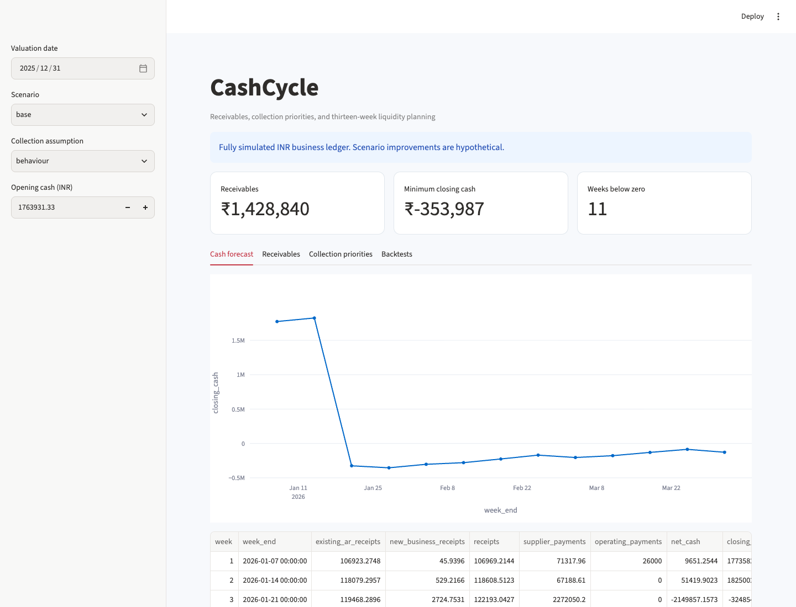

# CashCycle

An auditable receivables and liquidity-planning study showing how collection timing, payment commitments and new business shape a thirteen-week cash forecast.



## What it does

- Seeded synthetic invoices, partial receipts, credits, disputes, supplier bills, operating expenses and a committed equipment purchase.
- As-of receivables ageing and cash balances that exclude later payments and credits.
- Dollar-weighted product-limit collection curves with right censoring and a contractual-due-date baseline.
- Thirteen-week receipts and payment forecasts, collection-priority tables and explicit base/downside/improvement assumptions.
- Twelve historical forecast cutoffs with receipt error, closing-cash error and shortfall warnings.
- Interactive forecast/ageing review, formula-driven Excel plan, CSV evidence, PDF report and standalone scenario chart.

## Run locally

Python 3.12 is the tested runtime.

```bash
python3 -m venv .venv
source .venv/bin/activate
python -m pip install -e '.[dev]' -c constraints.txt
cashcycle run
streamlit run app.py --server.port 8516
```

Run these commands from this repository. For a non-editable installation or a different working
directory, set `PROJECT_ROOT` to the repository path. Raw downloads, local models and processed
datasets are ignored by Git; the run command regenerates them. Reports are included for review.
Network access is required for first-time public-data/model downloads where applicable.

`constraints.txt` records the dependency versions used in local validation. It is a tested version
constraint set, not a cross-platform hash lock. Ordinary dependency resolution still handles
platform-specific packages. Runtime dependencies are declared in `pyproject.toml`.

## Inspect the evidence

- analysis.pdf — assumptions, backtests and liquidity interpretation
- receivables_ageing.csv — invoice balances at valuation
- forecast_base.csv, forecast_downside.csv, forecast_improvement.csv — weekly forecasts
- collection_priorities.csv — expected near-term receipts by invoice
- backtests.csv — twelve valuation cutoffs and two methods
- cash_plan.xlsx — editable inputs, cash roll-forward formulas, controls and charts
- cash_scenarios.html — standalone interactive scenario chart

Outputs live in `reports/`. [Read the generated analysis](reports/analysis.md),
[methodology](docs/methodology.md), [data dictionary](data/README.md),
and [validation record](docs/validation.json).

## Data and scope

Fully simulated INR business ledger, seed 73. Invoice issuance spans 2024-01-01 to 2026-06-30; payments may occur later. Customer groups have simulated payment patterns, partial payments, credit notes and non-payment. A simulated INR 2,200,000 equipment purchase is committed on 2025-10-15 and due 2026-01-20. It is a capital outflow, not an operating expense. No real customer or bank records are used.

Per-source download records store hashes and timestamps. A pre-existing local download is
identified as such if its original retrieval time was not captured. `data/provenance.json`
records the dataset and treatment assumptions. Refresh public sources explicitly when needed;
refreshing can change results.

## Walkthrough

1. Inspect 2025-12-31 receivables and the ledger reconciliation.
2. Trace the January equipment commitment into the cash forecast.
3. Switch between due-date and behaviour-based collections, and inspect twelve-cutoff backtests.
4. Compare base, downside and seven-day improvement scenarios. Treat collection improvement as assumed, not causal.
5. Open the Excel plan, change receipt and payment multipliers, and inspect closing-cash formulas and zero-difference controls.

## Validate

```bash
python -m pytest -q
python -m ruff check src tests
python scripts/verify_artifacts.py
```

Unit tests use small, interpretable fixtures. Artifact verification checks reconciliations,
report/workbook structure and generated-file hashes. Generate the data before running the
artifact verifier. The validation record distinguishes executed checks from deployment configuration.

## Container

After generating the project data, build from this repository:

```bash
docker build -t cashcycle:local .
docker run --rm -p 127.0.0.1:8516:8501 cashcycle:local
```

The build copies generated local inputs so the application can open them. Rebuild after
regeneration. Docker configuration does not itself establish a hosted deployment. Development
servers bind to local ports in these examples.

## Layout

```text
src/cashcycle/     analytical code, CLI and application
tests/                correctness and boundary fixtures
data/                 provenance, dictionary and regenerable inputs
reports/              measured results and shareable artifacts
docs/                 methodology, preview and validation evidence
scripts/              standalone artifact verification
```
